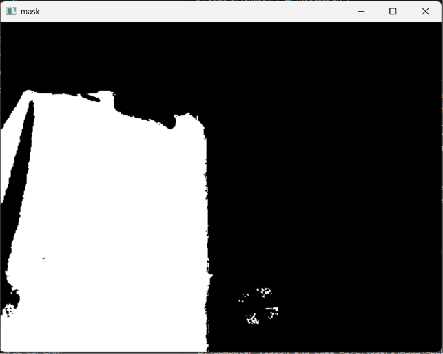

# cv-edge-ai-journey

Nhật ký học Computer Vision + Edge AI (11/2026 - 6/2029).

## 24/10/2026
- Đã làm: cài Python, VS Code, Git; tạo repo GitHub ; Cài đặt MSYS2 UCRT64, cấu hình g++ compiler và chạy chương trình hello.cpp đầu tiên.
- Chạy được: mở webcam bằng OpenCV (webcam.py)
- Mai làm: CS50P bài 0, đổi ảnh webcam sang ảnh xám
## 24/10/2026 (ngày 2)
- Đã làm: maytinh.cpp (máy tính 4 phép, chặn chia cho 0, kiểm tra toán tử)
- Đã học: kiểu `char`, `if / else if`, `int` so với `float`, `.gitignore`
- Đang dở: CS50P bài 1, thêm GaussianBlur/Canny vào webcam.py
## 25/10/2026 (ngày 3)
- Đã làm: maytinh.cpp chạy lặp bằng while, thoát khi gõ q
- Đã làm: maytinh.py chạy bằng while, thoát khi gõ q, kết hợp try/except
- Đã học: while, break, continue, std::string, cin đọc char chỉ lấy một ký tự mỗi lần
- Đang dở: xử lý khi gõ chữ vào chỗ nhập số (cin.clear, cin.ignore), CS50P bài 1
## 26/10/2026 (ngày 4)
- Đã làm: webcam.py hiện ảnh màu, ảnh xám, ảnh biên (Canny), mặt nạ HSV và kết quả lọc màu
- Đã học: HSV (Hue của OpenCV chạy 0-179), cv2.inRange, cv2.bitwise_and, làm mờ trước khi tìm biên
- Khoảng HSV đang dùng: lower = (100, 120, 70), upper = (130, 255, 255) (mặt nạ bắt đúng vật)

- Canny đã thử: (50,150) → nhận xét: nhiều viền hơn
- Đang dở: chỉnh khoảng HSV cho ổn định hơn, thử thêm cặp ngưỡng Canny
- Mai làm: findContours trên mặt nạ, vẽ khung quanh vật, in tọa độ tâm; lướt CS50P và NumPy nếu còn giờ
## 27/10/2026(ngày 5)
## 27/10/2026 (ngày 5)
- Đã làm: webcam_test.py tìm vật màu xanh bằng HSV, lấy contour lớn nhất (bỏ nhiễu dưới 500 pixel), vẽ khung, tính tọa độ tâm, tính sai số so với giữa khung hình (theo %) và in hướng (SANG TRAI / SANG PHAI / GIUA), có báo KHONG THAY VAT khi mất vật
- Đã học: findContours, boundingRect, contourArea, chuẩn hóa sai số theo chiều rộng khung, vùng chết (dead zone)
- Đã kiểm chứng: khăn xanh biển, khoảng HSV (100,120,70)-(130,255,255) bắt đúng vật, không dính tay
- Không đăng ảnh/GIF demo vì lộ thông tin cá nhân
- Đang dở: làm mượt sai số bằng trung bình trượt (deque), chưa đo trước/sau
- Tiếp theo: đo độ dao động (pstdev) khi giữ vật đứng yên, thử maxlen 3/5/10 rồi ghi nhận xét về đánh đổi giữa mượt và trễ
