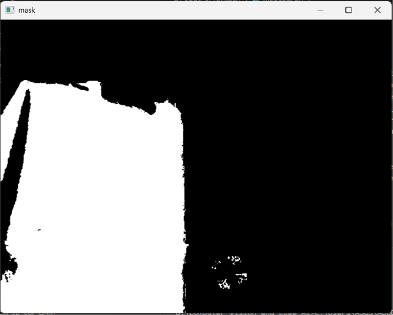

# cv-edge-ai-journey

Nhật ký học Computer Vision + Edge AI (11/2026 - 6/2029).

## 24/10/2026
- Đã làm: cài Python, VS Code, Git; tạo repo GitHub ; Cài đặt MSYS2 UCRT64, cấu hình g++ compiler và chạy chương trình hello.cpp đầu tiên.
- Chạy được: mở webcam bằng OpenCV (webcam.py)
- Mai làm: CS50P bài 0, đổi ảnh webcam sang ảnh xám
## 24/10/2026 (ngày 2)
- Đã làm: maytinh.cpp (máy tính 4 phép, chặn chia cho 0, kiểm tra toán tử)
- Đã học: kiểu `char`, `if / else if`, `int` so với `float`, `.gitignore`
- Đang dở: CS50P bài 1, thêm GaussianBlur/Canny vào webcam.py
## 25/10/2026 (ngày 3)
- Đã làm: maytinh.cpp chạy lặp bằng while, thoát khi gõ q
- Đã làm: maytinh.py chạy bằng while, thoát khi gõ q, kết hợp try/except
- Đã học: while, break, continue, std::string, cin đọc char chỉ lấy một ký tự mỗi lần
- Đang dở: xử lý khi gõ chữ vào chỗ nhập số (cin.clear, cin.ignore), CS50P bài 1
## 26/10/2026 (ngày 4)
- Đã làm: webcam.py hiện ảnh màu, ảnh xám, ảnh biên (Canny), mặt nạ HSV và kết quả lọc màu
- Đã học: HSV (Hue của OpenCV chạy 0-179), cv2.inRange, cv2.bitwise_and, làm mờ trước khi tìm biên
- Khoảng HSV đang dùng: lower = (100, 120, 70), upper = (130, 255, 255) (mặt nạ bắt đúng vật)

- Canny đã thử: (50,150) → nhận xét: nhiều viền hơn
- Đang dở: chỉnh khoảng HSV cho ổn định hơn, thử thêm cặp ngưỡng Canny
- Mai làm: findContours trên mặt nạ, vẽ khung quanh vật, in tọa độ tâm; lướt CS50P và NumPy nếu còn giờ
## 27/10/2026(ngày 5)
- Đã làm: webcam_test.py tìm vật màu xanh bằng HSV, lấy contour lớn nhất (bỏ nhiễu dưới 500 pixel), vẽ khung, tính tọa độ tâm, tính sai số so với giữa khung hình (theo %) và in hướng (SANG TRAI / SANG PHAI / GIUA), có báo KHONG THAY VAT khi mất vật
- Đã học: findContours, boundingRect, contourArea, chuẩn hóa sai số theo chiều rộng khung, vùng chết (dead zone)
- Đã kiểm chứng: khăn xanh biển, khoảng HSV (100,120,70)-(130,255,255) bắt đúng vật, không dính tay
- Không đăng ảnh/GIF demo vì lộ thông tin cá nhân
- Đang dở: làm mượt sai số bằng trung bình trượt (deque), chưa đo trước/sau
- Tiếp theo: đo độ dao động (pstdev) khi giữ vật đứng yên, thử maxlen 3/5/10 rồi ghi nhận xét về đánh đổi giữa mượt và trễ 
### Đo làm mượt sai số (vật hồng, maxlen = 5, khoảng 10 giây)
- Đã làm : đo làm mượt sai số mỗi maxlen 6 lần (3 lần ánh sáng trực tiếp, 3 lần ánh sáng giáng tiếp) lưu vào file [text](bang_so_sanh_maxlen.xlsx)
- Đang dỡ : kết luận từ file [text](bang_so_sanh_maxlen.xlsx) và đo độ trễ khi vật di chuyển
## 27-28/10/2026 (ngày 5-6)

### Đã làm
- webcam_test.py: lọc màu bằng HSV, lấy contour lớn nhất (bỏ nhiễu dưới 500 pixel), vẽ khung, tính tâm và sai số so với giữa khung hình (theo %), in hướng SANG TRAI / SANG PHAI / GIUA, báo KHONG THAY VAT khi mất vật
- Làm mượt sai số bằng trung bình trượt (deque), đo độ giật giữa các khung liên tiếp (nhieu) trước và sau lọc
- Đo có đối chứng ở 4 kịch bản: giantiep, tructiep, choi (ánh sáng đổi đột ngột), dichuyen (3 đến 7 lần mỗi kịch bản), lưu vào tong_hop.csv

### Kết quả (độ giảm nhiễu so với thô, cửa sổ 5)
| Kịch bản | Trung bình trượt (tb5) | Median (med5) |
| --- | --- | --- |
| giantiep | 59.5% | 6.0% |
| tructiep | 72.1% | 57.6% |
| choi | 59.3% | 24.1% |
| dichuyen | 27.5% | 19.1% |

- Trung bình trượt giảm nhiễu nhiều hơn median ở cả 12 cặp cùng cỡ cửa sổ. Lý do (giả thuyết): nhiễu là tâm khung nhích 1 pixel liên tục, không phải đột biến lẻ, mà median chỉ giỏi loại đột biến.
- Cỡ cửa sổ: tb5 trễ khoảng 2 khung, tb10 trễ khoảng 4 khung nhưng chỉ hơn rõ ở 1 trong 4 kịch bản. Chọn tạm maxlen = 5 (chưa đo trên xe thật).
- Ánh sáng ổn định (đèn chiếu thẳng hay quay đi) gần như không ảnh hưởng nhiễu. Nhiễu lớn đến từ ánh sáng đổi đột ngột (kịch bản choi, độ giật thô gấp khoảng 34 lần lúc ổn định).
- Kết quả âm tính: giả thuyết "lệch do ánh sáng yếu" không được dữ liệu ủng hộ.

### Đang dở
- Bản mới (khóa phơi sáng + loại khung bất thường) chưa hơn tb5 ở kịch bản nào, ở choi chỉ giảm 13.8% so với thô. Chưa rõ khóa phơi sáng có hiệu lực không (nhiều webcam bỏ qua lệnh này), và hai thay đổi đang gộp chung nên chưa tách được tác dụng từng cái
- Chưa đổi độ trễ từ khung hình sang mili giây (chưa đo fps thật)
- Kịch bản giantiep, tructiep mới có 3 lần đo, cần đủ 5

### 7/11/2026
- đã làm: thêm hàm sapxep; thêm cử sổ "phang"
- Tự động tìm được 4 góc ở ảnh giấy trên nền tương phản. Không chạy được với nền có họa tiết hoặc màu gần giấy(anh_giay_xeo.jpg và anh_giay_an.jpg). Chưa làm: nhị phân hóa thích nghi, nắn trên ảnh gốc, chọn góc bằng chuột.

### 8/11/2026
- Kernel làm mờ có trọng số dương, tổng bằng 1, nên mỗi pixel thành trung bình của vùng quanh nó. Sobel có tổng bằng 0 nên vùng phẳng cho 0, còn nơi độ sáng đổi từ trái sang phải cho giá trị lớn (dương hoặc âm tùy hướng đổi). Cùng một phép trượt và nhân, chỉ đổi số trong kernel là đổi từ làm mờ sang tìm biên.
- độ chênh 0.000244 và 0.000000, thời gian 2.67s so với 0.012s và 2.31s so với 0.002s, kèm lưu ý chỉ là một lần chạy

### 9/11/2026
- tao file tính trung bình, min, max, tong từ file so.txt bằng for của C++.
- File 4 5 abc 6: dự đoán chương trình đọc 4 và 5 rồi dừng ở abc, bỏ 6, và không báo lỗi gì.
### 11/11/2026
- Con trỏ: biến chứa địa chỉ của biến khác, nên dùng nó để đọc hoặc sửa thẳng biến gốc.
- &: lấy địa chỉ của một biến (&a).
- *: hai nghĩa tùy chỗ. Trong khai báo, int* p nghĩa là p là con trỏ tới int. Trong biểu thức, *p nghĩa là đi theo địa chỉ để lấy hoặc sửa giá trị ở đó.
- Theo giá trị: hàm nhận một bản sao của n ở địa chỉ khác, sửa bản sao nên n vẫn là 5.
- Theo con trỏ: hàm nhận địa chỉ của n rồi sửa thẳng n, nên ra 6.
- Theo tham chiếu: x chính là n dưới một tên khác, nên ra 7.
### 13/11/2026
- Ảnh trong máy tính là một ma trận giá trị pixel, và mỗi pixel có tọa độ là một vector. Nhân ma trận quan trọng với ảnh vì hai lẽ. Một là các phép biến đổi hình học như xoay, lật, kéo giãn, nghiêng đều là nhân ma trận với tọa độ (nắn phối cảnh dùng ma trận 3×3). Hai là xử lý ảnh nói chung, từ convolution đến mạng nơ-ron, đều dựa trên các phép tính ma trận. Thứ tự các phép biến đổi quan trọng vì nhân ma trận không giao hoán.